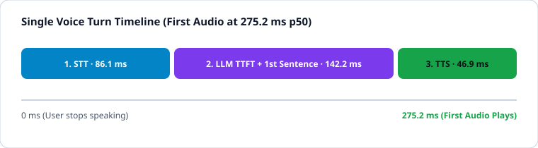
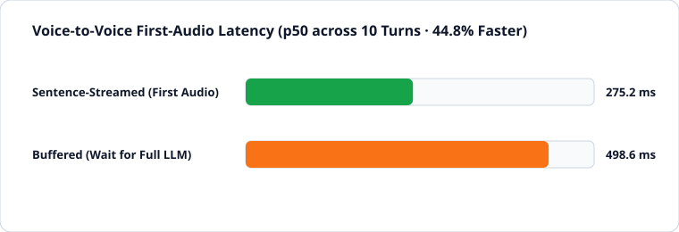

# Voice Agent Pipeline

[](https://www.python.org/)
[](https://fastapi.tiangolo.com/)
[](app/pipeline.py)

**Real-time voice agent pipeline (`STT → Streaming LLM → Sentence-Chunked TTS`) with per-stage latency instrumentation.** Instead of waiting for the full LLM response before synthesizing speech, the pipeline flushes each completed sentence directly to TTS, cutting voice-to-voice first-audio latency by **44.8%**.

<picture>
  <source media="(prefers-color-scheme: dark)" srcset="docs/img/turn-timeline-dark.svg">
  
</picture>

| **275.2 ms** | **498.6 ms** | **44.8%** | **86.1 ms** |
| :---: | :---: | :---: | :---: |
| p50 first-audio latency (sentence-streamed) | p50 first-audio latency (buffered baseline) | end-to-end latency reduction | p50 speech-to-text stage latency |

<picture>
  <source media="(prefers-color-scheme: dark)" srcset="docs/img/latency-dark.svg">
  
</picture>

Full 10-turn breakdown: **[docs/BENCHMARKS.md](docs/BENCHMARKS.md)**.

---

## Architecture

<picture>
  <source media="(prefers-color-scheme: dark)" srcset="docs/img/architecture-dark.svg">
   STT -> Streaming LLM -> Neural TTS -> Playback" src="docs/img/architecture-light.svg">
</picture>

## Quickstart

```bash
python3 -m venv .venv
source .venv/bin/activate
pip install -r requirements.txt

pytest -v
python scripts/bench_latency.py
uvicorn app.main:app --port 8000
```
